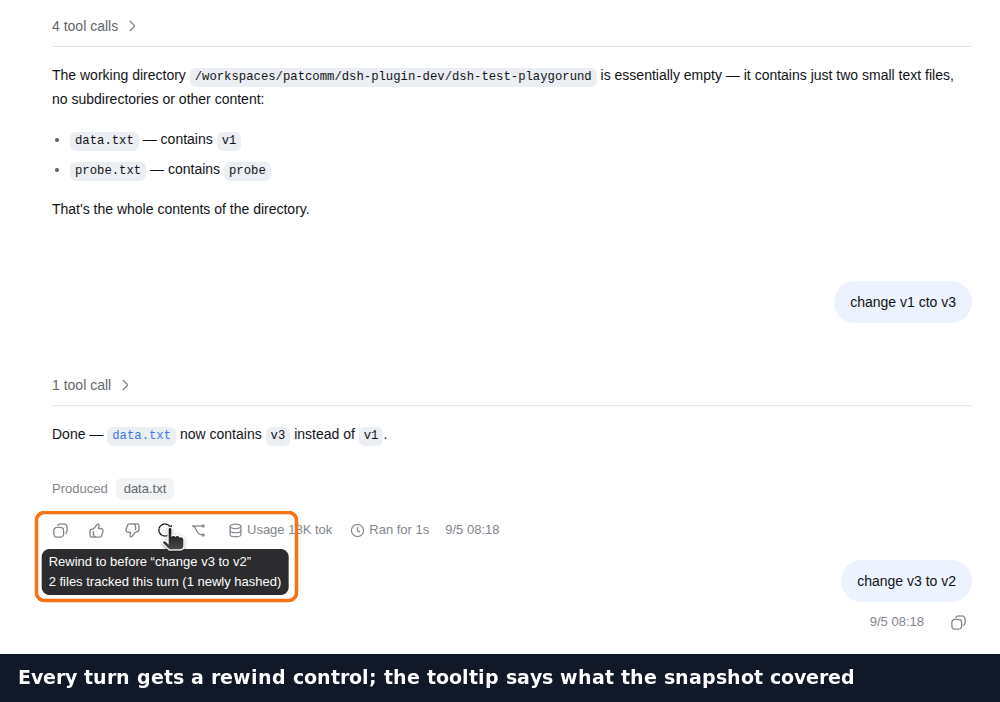
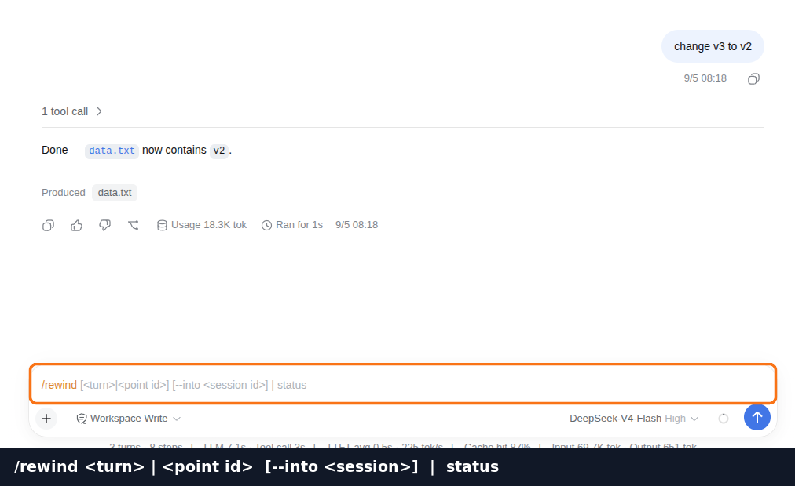
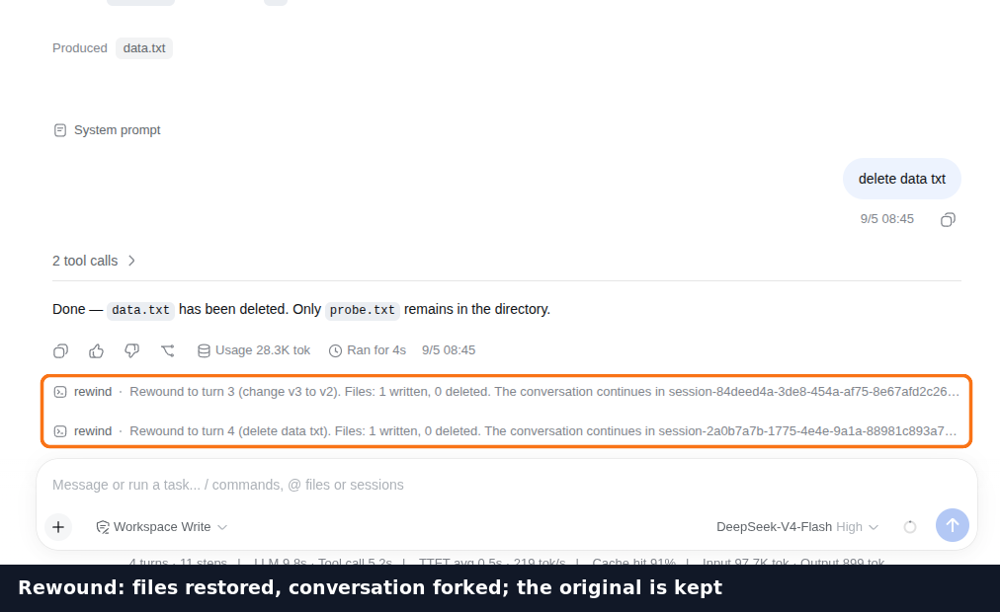
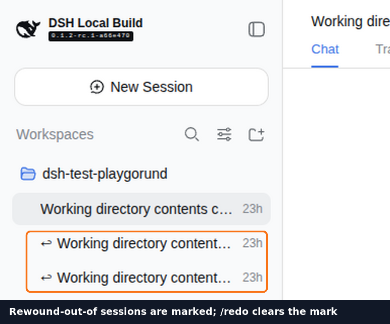
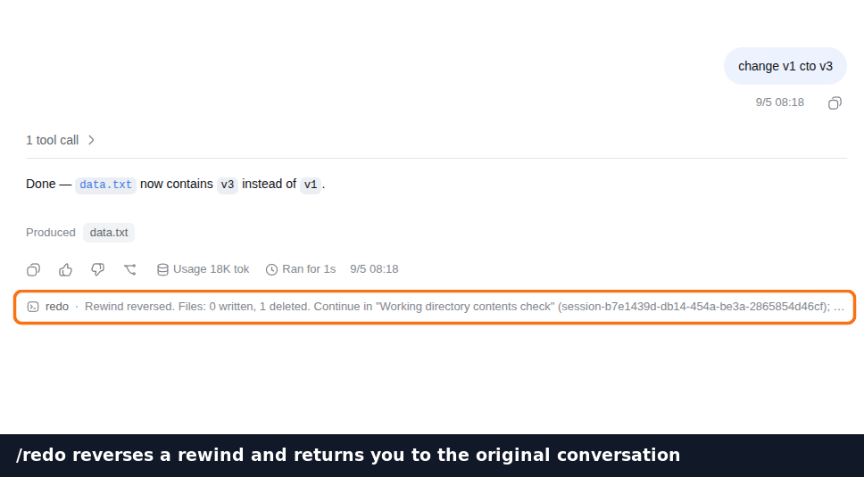
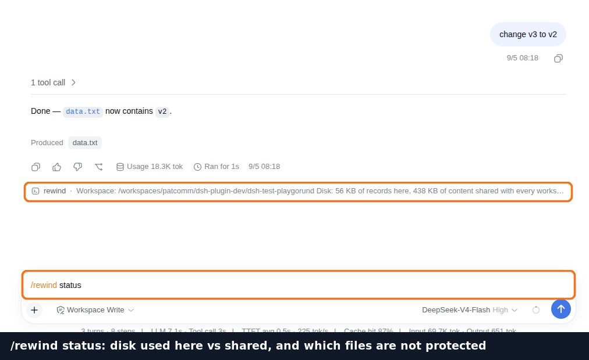

# DSH Rewind & Redo — by FileSnap

[](https://www.npmjs.com/package/dsh-filesnap)
[](https://github.com/extracurricular-ai/dsh-filesnap/actions/workflows/ci.yml)
[](LICENSE)
[](#为什么选择-dsh-filesnap)

[English](README.md) | 中文

[参与讨论](https://github.com/extracurricular-ai/dsh-filesnap/discussions) ·
[报告问题](https://github.com/extracurricular-ai/dsh-filesnap/issues/new?template=bug_report.yml)

**dsh-filesnap** 让你直接在
[DeepSeek Harness（DSH）](https://github.com/deepseek-ai/deepseek-harness) 聊天界面点击回退。
对话和已跟踪文件一起恢复，原对话完整保留。选错了回退点，再用 `/redo` 撤销。
带消息旁回退按钮和会话级 redo/status 控件，无需 Git 仓库。

**开发版新增：回退前文件清单与确认。** 点击回退按钮先查看将写回、恢复或删除的文件，确认后才执行；取消不创建分支、不改工作区文件。`/rewind <turn>` 同样先预览。此改动尚未发布，需 FileSnap 0.5.0+。[操作说明与边界](docs/rewind-preview.zh.md)。


[观看完整中文演示 · 2:24](https://www.bilibili.com/video/BV1BiYT6qEjs/) ·
[English walkthrough · 2:29](https://youtu.be/WPEXKesR_EM)


## dsh-filesnap 与 dsh-rewind-plugin 对比

与 **SiriLee 的 dsh-rewind-plugin 0.9.1** 相比，**dsh-filesnap 0.2.2**
搭配 **filesnap 0.4.0** 的明确优势是：**文件内容去重复用范围更广**，并且可以用
**`/redo` 撤销回退**。核查日期：2026-09-10。

标记：✅ 满足需求 · ⚠️ 有边界或额外成本 · ❌ 当前未提供 · ☠️ 历史变更无内置撤销；[完整对比与风险标记](docs/comparison.zh.md)。

| 你需要什么 | dsh-filesnap | dsh-rewind-plugin |
|---|---|---|
| **撤销选错的回退** | ✅ **`/redo`** | ❌ `/undo` 仅发起回退 |
| **同一文件 A → B → A** | ✅ **2 份正文** | ⚠️ 3 份正文 |
| **两个路径内容相同** | ✅ **共用 1 份** | ⚠️ 保存 2 份 |
| 对话与文件一起恢复 | ✅ 支持 | ✅ 支持 |
| **回退后仍能打开完整原对话** | ✅ **原会话保留** | ☠️ 后续历史被隐藏，无内置反向恢复¹ |

¹ SiriLee 的原始日志仍保留，文档说明可手工恢复；风险是失去正常流程中的完整回退前视图，
不是磁盘历史被删除。双方都有 Web UI 控件，也能联动恢复对话和文件。

仅回退对话和清理界面尚在 [roadmap](docs/roadmap.zh.md) 中，SiriLee 已提供这两项功能。

副本数来自**存储组件实验**，不是总磁盘体积或速度对比；双方都有元数据开销，
复用要求内容仍在存储中。参见 [7 组实验、版本和源码证据](docs/dedup-comparison.zh.md)
及 [使用方式比较](docs/comparison.zh.md)。

## 跨助手的回退实践

项目积累了 Codex、DSH 和 Pi 中的回退与恢复经验。
[查看相关项目及其关系](docs/cross-assistant.zh.md)。

## 快速开始

### 环境要求

- 带有 `web` 或 `headless` profile 的 DeepSeek Harness
- Node.js `^22.19` 或 `>=24`
- x64 或 arm64 架构的 Linux、macOS 或 Windows

所需组件随插件安装，无需另外安装工具链。

> [!IMPORTANT]
> **卸载不会删除对话记录或工作区文件。** 含插件记录的会话需重装插件后重新打开。
> 请使用构建版或 npm 安装的 DSH CLI；源码启动问题见
> [排障指南](docs/troubleshooting.zh.md)。

### 1. 安装

```console
$ dsh plugin --profile web add dsh-filesnap
```

安装到此为止：本包声明了 `dsh.bundle`，启动器会自己把它挂进 profile。headless
profile 把 `web` 换成 `headless` 即可。

> [!WARNING]
> **从 0.2.1 或更早升级？** 那些版本要求你在 `~/.dsh/profiles/<profile>/cordis.patch.yml`
> 里手动加一行 `id: filesnap`。**在 0.2.2 上启动 dsh 之前，先删掉那一行。** 现在 bundle
> 会提供同一行，loader 拒绝两个同 id 的条目，dsh 会起不来：
> `plugin tree failed to load: … duplicate loader entry id: filesnap`。

### 2. 验证并使用

```console
$ dsh --profile web --dump-config | grep -A 1 filesnap
- id: filesnap
  name: dsh-filesnap
```

重启 profile，完成一轮 agent 任务，然后输入 `/rewind`。如果组合后的 profile 中没有
插件，或浏览器控件没有出现，请看[排障指南](docs/troubleshooting.zh.md)。

## 第一次回退，一步一步来

截图来自 `web` profile 上 0.2.2 的真实会话。

**1. 跑一轮会改文件的任务，然后悬停到回复上。** 每条完成的 assistant 回复旁都有回退控件。
提示会说明目标轮次和本次快照覆盖范围。



**2. 或者输入 `/rewind`。** 选择列表中的轮次编号或恢复点。
数字表示指定轮次之前的状态，不是“往回退几轮”。



**3. 选一轮并确认。** 开发版先显示文件变更清单；确认后，对话和文件一起恢复到选定状态。下图为旧版执行结果。
按钮会打开可以继续操作的对话，原对话仍完整保留。



**4. 随时找到原对话。** 会话列表用箭头标记你离开的对话，方便之后辨认。



**5. 改主意了？在回退后打开的对话里执行 `/redo`。** 它反转这次回退，把你交还给原来的对话，标记随之消失。



**6. 随时 `/rewind status`。** 本工作区记录占的磁盘、共享内容存储占的磁盘，以及这里哪些
文件*没有*被保护、为什么。



## 为什么选择 dsh-filesnap

| | 意味着什么 |
|---|---|
| **对话 + 文件** | 直接在聊天界面把两者一起恢复到选定状态。 |
| **不依赖 Git** | 在 Git 仓库和普通目录中都能工作，不改变 commit、branch、stash 或 worktree 状态。 |
| **回退也能撤销** | 在还原写入前先创建救援点，`/redo` 可以撤销这次回退。 |
| **覆盖面更完整** | 支持二进制文件、被 Git 忽略的文件，以及经 `ctx.fs` 发生在项目目录外的编辑。 |
| **界面操作** | 消息旁点回退，会话头部有 redo 和 status 控件。 |
| **范围可检查** | `/rewind status` 会报告存储占用，以及哪些文件未被保护和对应原因。 |

这套设计不会把版本控制当作快照仓库。带版本日期和源码审计的完整对比见
[插件对比](docs/comparison.zh.md)。

## 命令

| 命令 | 结果 |
|---|---|
| `/rewind` | 列出每轮开始前捕获的工作区状态。 |
| `/rewind <turn>` | 开发版：预览回退到指定轮次之前将变更的文件。 |
| `/rewind <turn> --confirm <token>` | 开发版：使用预览给出的令牌确认恢复。 |
| `/redo` | 撤销落在当前会话中的回退。 |
| `/rewind status` | 报告存储内容和当前未受保护的文件。 |

`/rewind` 接受列表中显示的轮次编号或 point id。它刻意不支持“往回三轮”这样的相对
寻址：还原会覆盖文件，因此目标必须明确。

这两个命令都不会触发模型轮次。回退是用户对对话执行的操作，不应该再经过被回退的对话。

## 哪些文件会被保护

恢复依赖事先捕获。FileSnap 覆盖已跟踪文件、观察到的编辑，以及有限范围内的近期工作区变化。
忽略规则、大小限制和捕获时机仍会影响覆盖；它不是整台电脑所有文件的备份。

用 `/rewind status` 检查覆盖范围。恢复会修改当前工作区，打开旧对话不会切换到独立的文件副本。
[覆盖与恢复细节](docs/architecture.zh.md)。

## 性能

引擎运行在模型请求之前，而模型请求通常需要数秒。当前在 warm page cache 下得到的初步
测量是：

| 工作区 | 捕获文件数 | 首次捕获 | 重复捕获 |
|---|---:|---:|---:|
| 本仓库 | 84 | 20 ms | **8 ms** |
| DeepSeek Harness monorepo | 磁盘上 70,918 个文件中的 7,995 个 | 1.75 s | **268 ms** |

这些数字只描述原始测量机器，不是对所有设备的承诺。跟踪集合是有界的，不会每轮遍历
70,918 个文件；重复捕获还会复用未变化的内容。测量方法、尚缺的机器元数据和复现命令见
[基准测试](docs/benchmarks.zh.md)。

## 配置

默认值适用于普通本地部署。

| 字段 | 默认值 | 用途 |
|---|---|---|
| `command` | 自动解析 | 指向另一个引擎构建，或由远程 subprocess provider 解析的裸命令。 |
| `dataDir` | 平台数据目录 | 存储位置，永远不在项目目录中。 |
| `timeoutMs` | `120000` | 单次引擎调用的墙钟上限。 |
| `graceMs` | `2000` | 取消或超时后从 SIGTERM 到 SIGKILL 的宽限时间。 |
| `maxOutputBytes` | `1048576` | 每条输出流的内存上限。 |
| `declareEdits` | `true` | 在编辑之前立即记录文件 pre-image。 |

未知字段和不可用值会在插件加载时失败，不会等到某次回退点悄悄消失后才暴露。

## 当前限制

- 卸载不会删除对话记录或工作区文件；含插件记录的会话需重装插件后重新打开。
- 浏览器按钮会打开恢复后的对话；手动输入 `/rewind` 会返回继续目标，需要打开它，不会自动跳转。
- 只能恢复已捕获内容，使用前检查文件覆盖范围。
- 仅回退对话、清理界面与逐文件恢复仍在 [roadmap](docs/roadmap.zh.md) 中。

[操作排障](docs/troubleshooting.zh.md) · [工作原理](docs/architecture.zh.md)

## 文档

| 文档 | 回答什么问题 |
|---|---|
| [工作原理](docs/architecture.zh.md) | 实现分工、原对话保留及恢复顺序。 |
| [界面与集成 FAQ](docs/faq.zh.md) | 界面能力、接入证据和兼容范围。 |
| [路线图](docs/roadmap.zh.md) | 清理、恢复预览及操作改进计划，不代表已发布功能。 |
| [插件对比](docs/comparison.zh.md) | 不同 dsh rewind 设计的区别，并标明审计版本。 |
| [基准测试](docs/benchmarks.zh.md) | 已发布的时间数据意味着什么，以及如何复现。 |
| [排障指南](docs/troubleshooting.zh.md) | 安装、profile、client bundle 和存储诊断。 |
| [参与贡献](CONTRIBUTING.zh.md) | 本地开发、构建和四层测试。 |

## 参与贡献

欢迎用中文或英文参与：

- [Discussions](https://github.com/extracurricular-ai/dsh-filesnap/discussions)：问题、想法和使用案例；
- [Issues](https://github.com/extracurricular-ai/dsh-filesnap/issues)：bug 和明确的改进项；
- [Pull requests](https://github.com/extracurricular-ai/dsh-filesnap/pulls)：已经实现的修改。

修改 host/engine 边界前请阅读 [CONTRIBUTING.zh.md](CONTRIBUTING.zh.md)。安全问题请通过
[SECURITY.md](SECURITY.md) 中的私有渠道报告，不要创建公开 issue。

## 许可证

Apache-2.0，见 [LICENSE](LICENSE)。它使用的
[filesnap](https://github.com/extracurricular-ai/filesnap) 引擎采用同一许可证。
